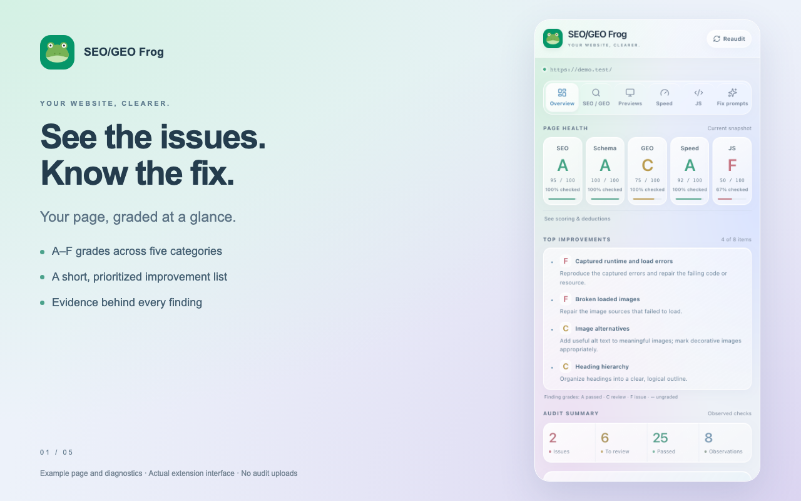

# SEO/GEO Frog 🐸

An open-source Chrome extension for local SEO, generative engine optimization (GEO), speed, and JavaScript diagnostics. Get A–F category grades, useful evidence, search and social previews, and prompts you can paste into Claude or another coding tool to fix findings.

**Pull requests are welcome!** Help improve checks, fix bugs, refine previews, or make the interface easier to use. See [CONTRIBUTING.md](CONTRIBUTING.md) to get started, or [open an issue](https://github.com/flyptkarsh/seo-geo-frog/issues) with an idea.



## Features

- **SEO and structured data:** inspect titles, meta descriptions, canonical and robots tags, headings, images, links, and JSON-LD syntax and basic fields.
- **GEO signals:** review content structure, attribution, and dates where relevant.
- **Report cards:** A–F category grades with a disclosed rubric and prioritized improvement bullets.
- **Previews:** dedicated icon tabs for approximate Google, Bing, Facebook, LinkedIn, and X cards.
- **Speed:** available navigation timings, resource sizes, blocking-script candidates, and image sizing.
- **JavaScript:** observe new runtime errors, unhandled rejections, resource failures, and long tasks after monitoring starts.
- **Fix prompts:** generate editable prompts for individual findings or a collection of actionable items. Copy them into Claude, Codex, Cursor, or another coding tool with your repository.
- **Learn as you audit:** each finding links to explanatory documentation, with a compact concept guide for every tab.
- **Native side panel:** compact glass styling, manual reaudit, and automatic refresh on authorized page navigation while the panel is open.

Accessibility auditing is planned for a later release. Existing image-alt and link-label checks are not a comprehensive accessibility audit.

## Install locally

Requires **Chrome 116+**. There is no build step and no runtime package dependency.

1. Clone this repository or download and extract its source ZIP.
2. Open `chrome://extensions` and enable **Developer mode**.
3. Choose **Load unpacked** and select the repository folder containing `manifest.json`.
4. Open a website and click the frog toolbar icon. Pin it for easy access.

Click the extension reload button on `chrome://extensions` after editing source files. Click the frog icon on a new origin to grant temporary access. Chrome-protected pages cannot be audited.

## Development

Use Node.js 24.15+ (24.x LTS or 26+) and npm:

```sh
git clone https://github.com/flyptkarsh/seo-geo-frog.git
cd seo-geo-frog
npm ci
npm test
```

Run the Chromium integration and layout checks as well:

```sh
npx playwright install chromium
npm run test:browser
```

Both suites run in GitHub Actions on pushes and pull requests. The 27 automated tests cover audit data, grades, prompt scope and clipboard fallback, export versioning, unsafe preview URLs, optional images, documentation links, navigation races, and retry recovery. Browser checks exercise real audit functions on a controlled page, confirm native side-panel opening, and check all tabs at 320, 390, and 600 pixel widths.

The browser audit fixture bridges Chrome APIs to a controlled test page; it does not simulate every real site's behavior or fully automate toolbar permission grants. Tests use jsdom and mocked Chrome APIs. Also load the extension in Chrome to verify actual side-panel behavior, navigation, permissions, previews, and reaudit.

| Files | Responsibility |
| --- | --- |
| `audit.js` | Rendered-page SEO, GEO, and structured-data checks |
| `diagnostics.js` | Performance observations and runtime monitoring |
| `grades.js`, `summary.js` | Category scoring and prioritized improvements |
| `social.js` | Search and social preview data and rendering |
| `prompt.js` | Coding-tool fix prompts |
| `popup.js`, `popup.html`, `popup.css`, `glass.css`, `icons.js` | Side-panel interface |
| `background.js` | Toolbar action and panel opening |
| `tests/audit.test.cjs` | Automated regression tests |

## Privacy and limitations

Analysis runs locally on the current top-level page. There is no developer analytics service, account, AI API call, persistent audit storage, or background site crawler. The extension uses only `activeTab`, `scripting`, and `sidePanel` permissions. New origins require another toolbar click.

Preview images load only when you click **Load image**; that requests the image from its host without a referrer. Runtime monitoring remains in the page until stopped or navigation. Reports and prompts may contain page URLs, metadata, structured data, and error details: review them before sharing.

Grades are diagnostic heuristics, not ranking predictions, AI citation guarantees, Lighthouse scores, or field Core Web Vitals. Previews are approximations; platforms can rewrite or cache them. JSON-LD parsing does not validate all schema.org or rich-result requirements. Errors that occurred before monitoring began are not captured.

See [audit details and scoring](docs/AUDIT-DETAILS.md), [privacy policy](https://www.loungefrog.com/privacy), and [terms](https://www.loungefrog.com/terms).

## Contributing

**Anyone can propose a change through a pull request.** Fork the repository, create a branch, make a focused change, run the tests, and open a PR explaining what changed and how you verified it. For larger features, open an issue first to discuss scope. Bug reports, documentation fixes, and thoughtful check improvements are welcome too.

See the [contribution guide](CONTRIBUTING.md). Please use synthetic examples instead of publishing private page content or browsing data.

## License and credits

Project code is available under the [MIT license](LICENSE). Bundled Lucide icons retain their [ISC license](icons/lucide/LICENSE); Simple Icons retain their [CC0 notice](icons/SIMPLE-ICONS-LICENSE.md). Brand names and logos remain subject to their owners’ trademark rights; the license does not grant trademark rights or imply endorsement.

Created by [Patrick Karsh](https://www.linkedin.com/in/patrickarsh/) · [GitHub](https://github.com/flyptkarsh) · [Lounge Frog](https://www.loungefrog.com)
